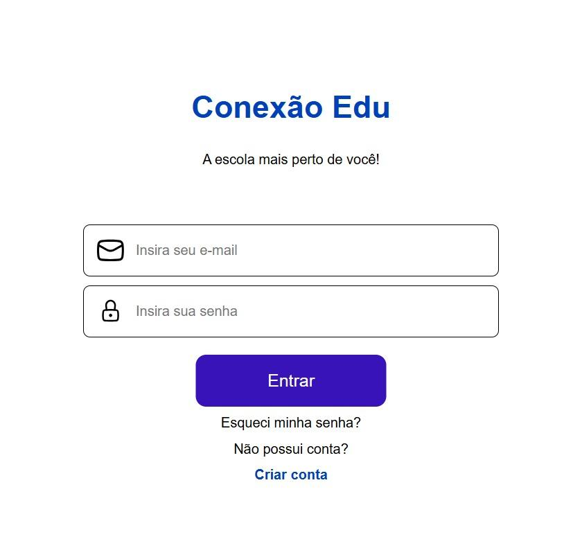
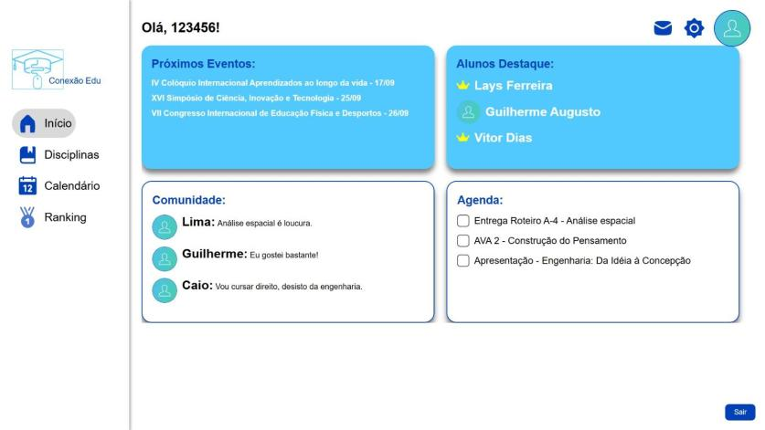
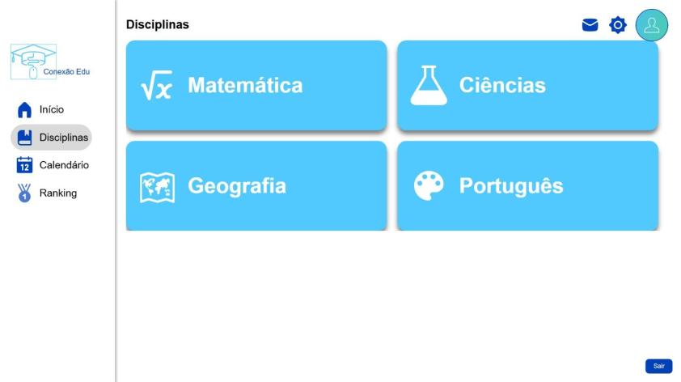

# Conexão Edu 🎓

**Plataforma educacional acadêmica** desenvolvida para organizar o acesso a conteúdos e acompanhar ações do sistema por meio de eventos. Projeto realizado na disciplina de **Desenvolvimento Backend** do curso de Engenharia de Software da Universidade Veiga de Almeida (UVA), em 2026.

> Este é um projeto de estudo, não um serviço pronto para produção. O banco H2 é temporário e os mecanismos de segurança precisam de revisão antes de uma implantação pública.

## Prévia da aplicação

| Tela de acesso | Painel principal |
| --- | --- |
|  |  |



*Imagens extraídas do relatório acadêmico apresentado pela equipe.*

## Funcionalidades

- Cadastro e autenticação de usuários com **JWT** e hash de senhas com **BCrypt**.
- Rotas REST para consulta e manutenção de **cursos** e **publicações** (CRUD).
- Frontend com login, painel inicial, disciplinas, calendário e ranking.
- Produção e consumo de eventos via **RabbitMQ** em ações como cadastro e alterações.
- Painel de monitoramento que consulta `/monitor/eventos` periodicamente.
- Ambiente com **Docker Compose**, iniciando o backend e o RabbitMQ.

## Tecnologias

| Camada | Tecnologias |
| --- | --- |
| Backend | Java 17, Spring Boot 3.2, Spring Web, Spring Data JPA, Spring Security |
| Autenticação | JWT, BCrypt |
| Mensageria | RabbitMQ, Spring AMQP |
| Banco de dados | H2 em memória (ambiente acadêmico) |
| Frontend | HTML, CSS e JavaScript |
| Execução | Maven, Docker e Docker Compose |

## Estrutura do repositório

```text
Conexao-Edu/
├── src/
│   └── main/
│       ├── java/com/conexaoedu/
│       │   ├── config/           # Mensageria
│       │   ├── controller/       # Endpoints REST
│       │   ├── model/            # Entidades
│       │   ├── repository/       # Acesso a dados
│       │   ├── security/         # JWT e configuração de segurança
│       │   └── service/          # Regras de negócio e eventos
│       └── resources/
│           ├── static/           # HTML, CSS, JS e imagens
│           ├── application.properties
│           ├── application-docker.properties
│           ├── schema.sql
│           └── data.sql
├── docs/
│   ├── screenshots/
│   ├── ARQUITETURA.md
│   └── PUBLICACAO.md
├── Dockerfile
├── docker-compose.yml
├── pom.xml
├── .env.example
├── .gitignore
└── README.md
```

**Nota:** as pastas já utilizadas pelo Maven e as URLs do frontend foram preservadas para evitar alterações desnecessárias no funcionamento da aplicação. `target/` e configurações de IDE não fazem parte da versão publicada.

## Como executar (recomendado: Docker)

**Pré-requisitos:** Docker com Docker Compose.

1. Clone o repositório e entre na pasta:

   ```bash
   git clone https://github.com/SEU-USUARIO/conexao-edu.git
   cd conexao-edu
   ```

2. Crie seu arquivo de configuração a partir do exemplo:

   ```bash
   cp .env.example .env
   ```

   No Windows, também é possível copiar o arquivo pelo Explorador de Arquivos. Edite `.env` e substitua `RABBITMQ_PASSWORD` e `JWT_SECRET` por valores privados e fortes. Para gerar uma chave JWT, por exemplo:

   ```bash
   python -c "import secrets; print(secrets.token_hex(32))"
   ```

3. Inicialize os serviços:

   ```bash
   docker compose up --build
   ```

4. Abra no navegador:

   - **Aplicação:** http://localhost:8080/
   - **Painel de monitoramento:** http://localhost:8080/monitor.html
   - **Administração do RabbitMQ:** http://localhost:15672/ (credenciais de seu `.env`)

5. Para encerrar:

   ```bash
   docker compose down
   ```

### Execução local sem Docker

Instale Java 17, Maven e um servidor RabbitMQ acessível em `localhost:5672`. Exporte `JWT_SECRET`, `RABBITMQ_USER` e `RABBITMQ_PASSWORD` no terminal (os valores do arquivo `.env` **não são carregados automaticamente pelo Maven**). Depois execute:

```bash
mvn spring-boot:run
```

O projeto está configurado para usar **H2 em memória**, recriado quando a aplicação reinicia. Os arquivos `src/main/resources/schema.sql` e `data.sql` documentam a estrutura e os dados iniciais.

## Endpoints principais

| Método | Rota | Descrição |
| --- | --- | --- |
| POST | `/auth/register` | Cadastrar usuário |
| POST | `/auth/login` | Autenticar usuário |
| GET | `/auth/me` | Consultar usuário autenticado |
| GET, POST | `/cursos` | Listar e cadastrar cursos |
| GET, PUT, DELETE | `/cursos/{id}` | Consultar, editar e excluir curso |
| GET, POST | `/posts` | Listar e cadastrar publicações |
| GET, PUT, DELETE | `/posts/{id}` | Consultar, editar e excluir publicação |
| GET | `/monitor/eventos` | Consultar eventos recentes |

As rotas protegidas usam `Authorization: Bearer <token>`; a configuração de segurança deve ser revisada antes do uso em produção.

## Arquitetura e cuidados de publicação

Consulte [ARQUITETURA.md](docs/ARQUITETURA.md) para conhecer os componentes e [PUBLICACAO.md](docs/PUBLICACAO.md) para revisar configurações e limitações antes de disponibilizar publicamente.

## Créditos

Projeto acadêmico realizado em equipe por João Adolfo Martins Araújo, João Vitor Souza da Silva, João Carlos Sequeira Candezuner, Jullie da Silva Nunes, Yago Levi Rodrigues Loureiro, Luiz Henrique Simões Soares e Guilherme Augusto Souza. 

---

*Projeto acadêmico para estudo e demonstração de conhecimentos de desenvolvimento backend.*
