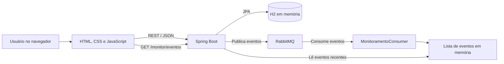

# Arquitetura — Conexão Edu

## Visão geral

A aplicação combina frontend estático servido pelo Spring Boot, uma API Java e um serviço de mensageria RabbitMQ.

## Organização do código

- `controller/`: recebe requisições REST (autenticação, cursos, posts e eventos).
- `service/`: centraliza regras de negócio e produção/consumo de mensagens.
- `repository/`: interfaces de acesso aos dados com Spring Data JPA.
- `model/`: entidades de usuário, curso e postagem.
- `security/`: autenticação JWT, filtro de autorização e configuração HTTP.
- `config/`: definição da fila RabbitMQ.
- `src/main/resources/static/`: frontend e recursos visuais.
- `schema.sql` e `data.sql`: estrutura e dados iniciais usados no ambiente acadêmico.

## Ambiente e fluxo de execução

1. `docker compose up --build` constrói e inicia o backend e o RabbitMQ.
2. O usuário acessa a aplicação pela porta 8080.
3. O frontend realiza chamadas REST ao backend.
4. A aplicação persiste dados temporários no H2 e envia eventos para a fila do RabbitMQ.
5. O consumidor lê a fila e atualiza uma lista em memória com os eventos recentes.
6. `monitor.js` consulta a rota `/monitor/eventos` a cada três segundos.

> O painel de monitoramento mantém eventos apenas em memória, sem persistência de longo prazo; a API e o frontend usam abordagens simplificadas, adequadas ao contexto de estudo.
